# 星愿池 ⭐

> 打卡攒星星，星星换心愿 —— 把每一次坚持，都变成夜空里的一条星光大道。

🌐 **推广官网**：[https://www.bigchange.top/](https://www.bigchange.top/)（自定义域名，由 GitHub Pages 部署）

**星愿池** 是一款 HarmonyOS（鸿蒙）习惯养成激励应用。通过游戏化的星星奖励机制，帮助家庭成员（尤其是孩子）建立良好的日常习惯：每日打卡评分攒星星，星星兑换心愿奖励，连续打卡点亮星路、收集 12 生肖星星朋友，让成长变得有趣又有动力。

鸿蒙设备可在华为应用市场搜索「**星愿池**」下载。

---

## ✨ 核心功能

### 📝 每日打卡评分

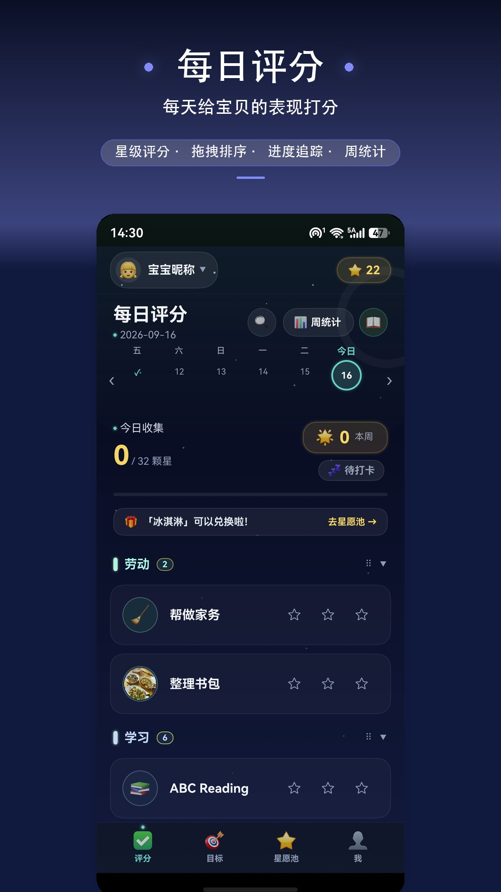

打卡不是终点，评分才是。按当日任务完成情况打分（0-5 星），把「完成情况」变成看得见的分数，让目标形成闭环：执行 → 打分 → 复盘 → 改进。

- ✅ 每日打卡后按完成情况打分，量化完成质量
- 📊 分数持续记录，趋势比感觉更诚实
- ⏰ 目标到点提醒，完成后马上评分，不拖延、不积压
- ⭐ 评分收获星星，攒星兑换心愿奖励，坚持更有动力

> 完整介绍见 [comments.md](comments.md)

---

### 🎯 目标管理

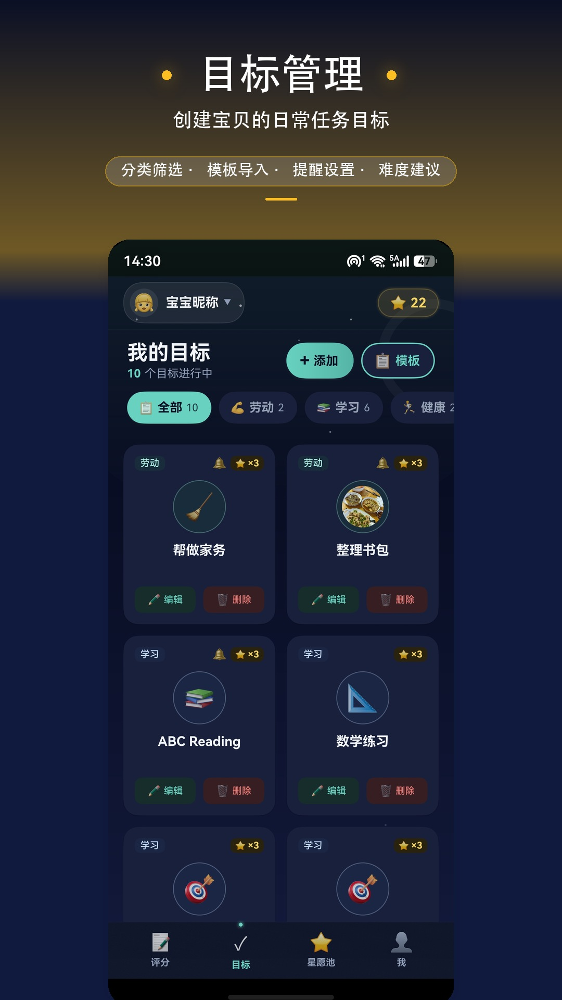

很多人不是没目标，而是目标只停在脑子里。把「我想做」变成「每天做什么」。

- 🎯 自由创建目标：学习、健身、读书、早起、学英语、戒熬夜……想做什么就建什么
- ⏰ 每个目标单独提醒：目标不靠记性，靠系统
- 📅 生效日期、共享目标、自定义分类、Emoji/图片图标
- 💡 内置日常习惯、学习安排、假期计划、阶段衔接四套模板，可勾选导入
- 📈 难度建议角标：连续满分建议调高星级，完成率偏低建议调低，点击直达编辑

> 完整介绍见 [goals.md](goals.md)

---

### 🧩 子项清单

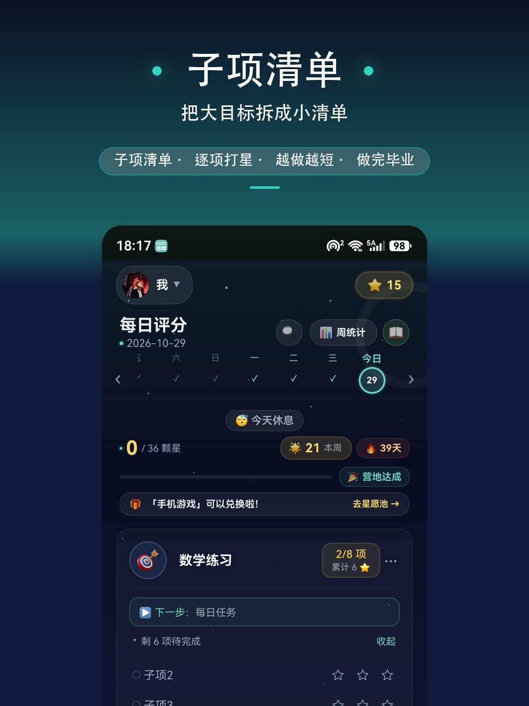

「读完一本书」「背完 500 个单词」，放进每日打卡就成了天天要评一次的无限任务。子项清单把大目标拆小，做完一项，少一项。

- 🧩 新建/编辑目标时可挂子项清单（选填，最多 8 项）：暑假作业分 10 章、背 50 词分 5 组
- 📉 逐项一次性：评过分当天亮 ✓，从第二天起不再出现，评分卡只摆还没完成的
- ⭐ 每项单独评分攒星，全部做完共赚「项数 × 星级」颗星
- 🏁 全部完成目标自动「毕业」，留一枚「✅ 已完成 · 共 N⭐」纪念章；想续写编辑追加即重开
- ↩️ 忘评不怕，3 天内可回评历史日期

> 完整更新说明见 [xhs_v160_update.md](xhs_v160_update.md)

---

### 🌌 点亮星路

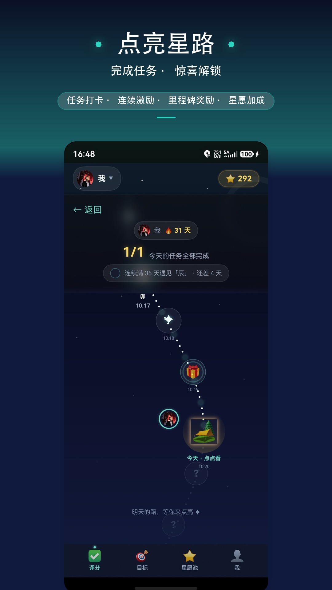

干巴巴的数字不如一条发光的轨迹。每天完成全部任务，点亮星路上的一个节点，点串成蜿蜒的星空之路。

- 🌟 星空轨迹步步留痕：哪天打了卡、哪天断了签，星轨上清清楚楚
- 🔥 连续打卡火焰：顶部醒目的「连续 XX 天」是你自律的最佳勋章
- 🎁 里程碑惊喜：路边宝箱开箱得星，连续满特定天数遇见生肖星星朋友（子鼠 → 亥猪，84 天集齐 12 张）
- ☄️ 集齐 12 次彩蛋，首次合成隐藏的彗星稀有卡

> 完整介绍见 [starpath.md](starpath.md)

---

### 📊 打卡统计与星图分享

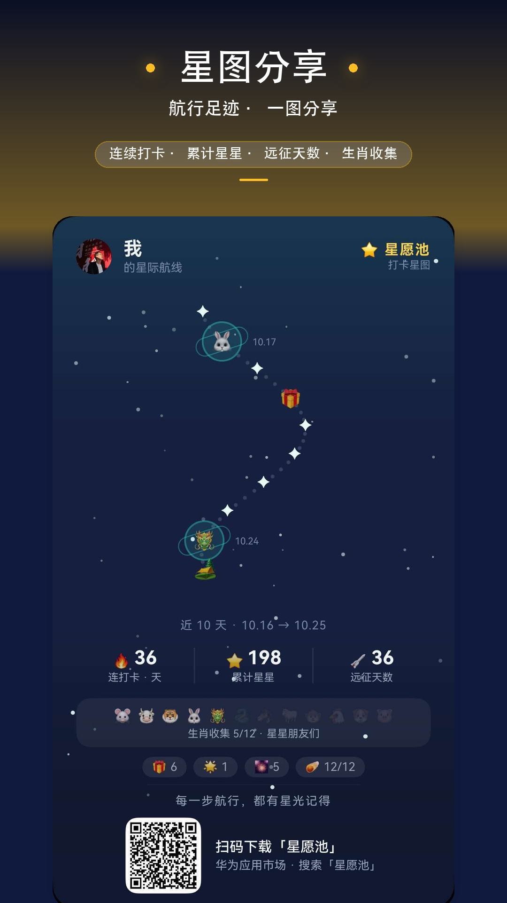

不统计，全靠感觉；一统计，心里有数。

- 📈 坚持天数可回看：打卡了多少天、哪天断了、哪天完成得好，回看就知道
- 👥 多用户独立统计：自己、家人各用各的，数据相互隔离
- 🚀 远征日志：星图顶部一行「远征 N 天 · M 星 · 彩蛋 · ☄️ 彗星进度」积累总览
- 📤 一键分享：把近段航线缩影生成夜空分享长图，连打卡、累计星、12 生肖收集点阵、下载二维码一应俱全，发到家长群/朋友圈就能晒

> 完整介绍见 [statistic.md](statistic.md)

---

### 🎁 星愿兑换

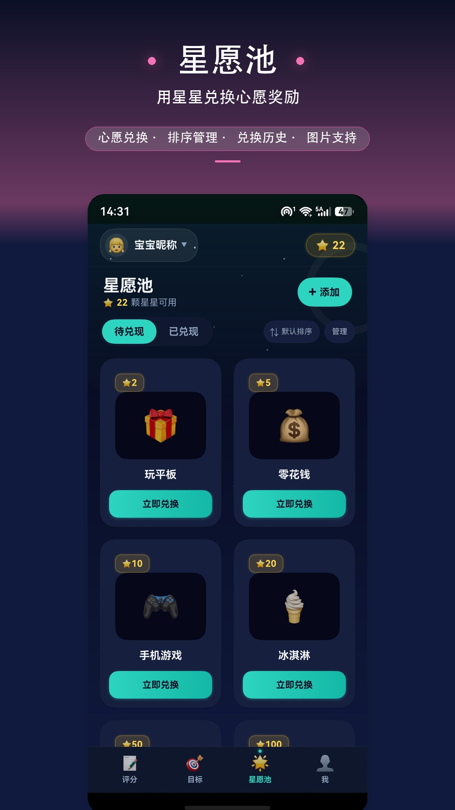

打卡攒星星，星星换心愿。坚持不该只有苦，还该有奖励。

- ⭐ 完成打卡评分，攒下星星
- 🎁 心愿自己定：看一部电影、喝杯奶茶、短途旅行……奖励你说了算
- 📈 星星进度看得见：「再攒 N 颗星就能兑换心愿」实时提示
- 🎉 攒够就兑换：亲手兑换心愿，成就感拉满；支持双视图（待兑现/已兑现）、排序与兑换历史

> 完整介绍见 [wishpool.md](wishpool.md)

---

### ✨ 星星时刻

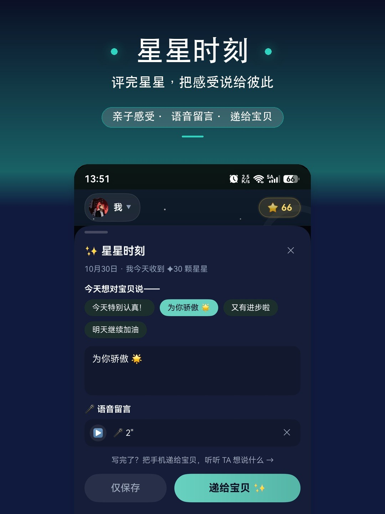

评完星星，别急着退出。当天全部任务评完、庆祝落幕后自动弹出「星星时刻」，把今天最想说的那句话留给彼此。

- ✨ 一天一次自动弹出，不额外打扰；也可以只保存稍后再说
- 👍 快捷鼓励一点即发：「今天特别认真！」「为你骄傲 🌞」「明天继续加油」
- 🎙 文字不够就录一段语音留言，麦克风权限只在第一次录音时询问
- 🤙 写完把手机递给宝贝，听听 TA 想说什么

### 💬 宝贝回应

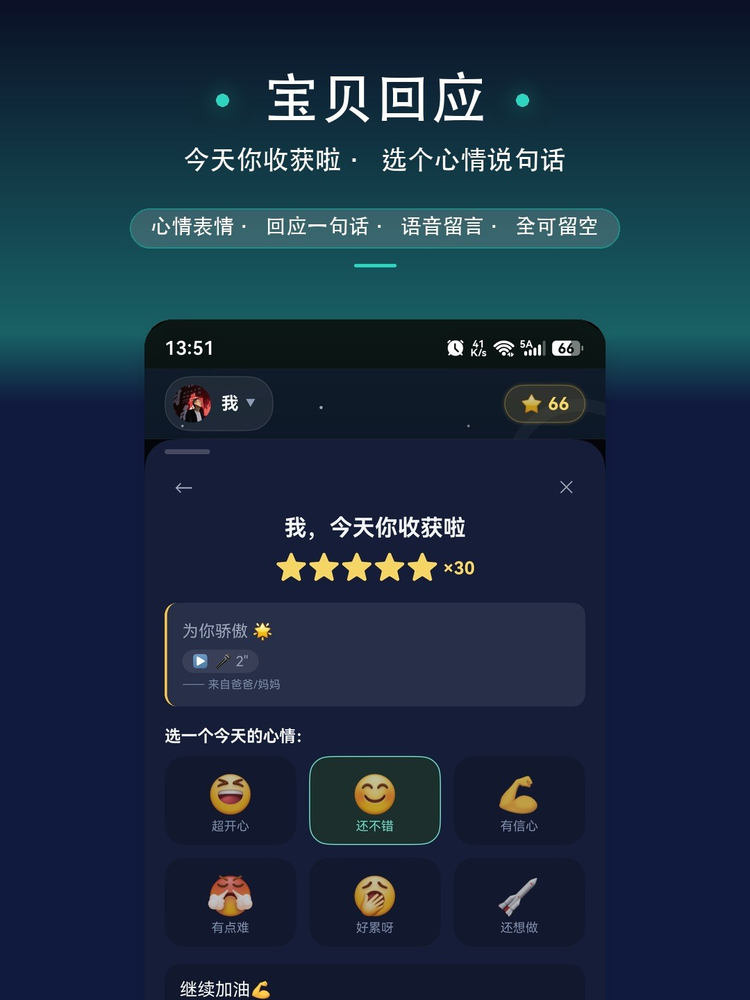

宝贝一进来先看到「今天你收获啦 ⭐ ×N」和爸爸妈妈的话，然后轮到 TA 表达今天的心情——感受双向流动。

- 😊 六种心情选一个：超开心、还不错、有信心、有点难……
- 💬 回一句话或录一段语音，也可以全部留空直接完成
- 🌈 大按钮、不依赖文字，不识字也能参与
- 📔 家长的鼓励和宝贝的回应一起存进成长日记

> 完整更新说明见 [xhs_v161_update.md](xhs_v161_update.md)

---

### 📱 桌面服务卡片

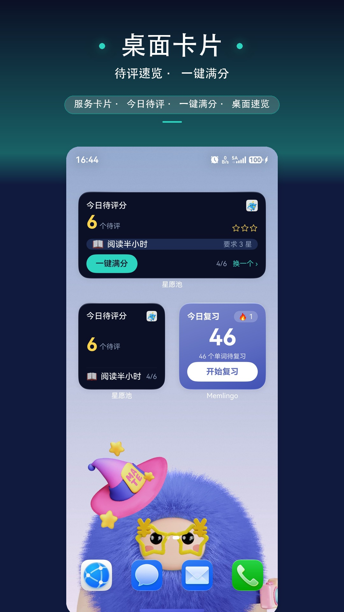

好习惯的养成，不应该有繁琐的门槛。把「今天还有什么没做」直接摆到桌面。

- 📱 2×2 / 2×4 两种尺寸服务卡片，桌面一眼看清今日待评分任务
- ⚡ 一键满分：赶时间时轻轻一点，后台静默完成评分并即时刷新卡片，不用打开 App
- 🔄 每 30 分钟自动轮换展示目标，长按可「换一个」，重点突出
- 🎯 点击卡片直达评分页，自动滚动定位到该目标并高亮

> 完整介绍见 [widgets.md](widgets.md)

---

### 👨‍👩‍👧 多用户与个人中心

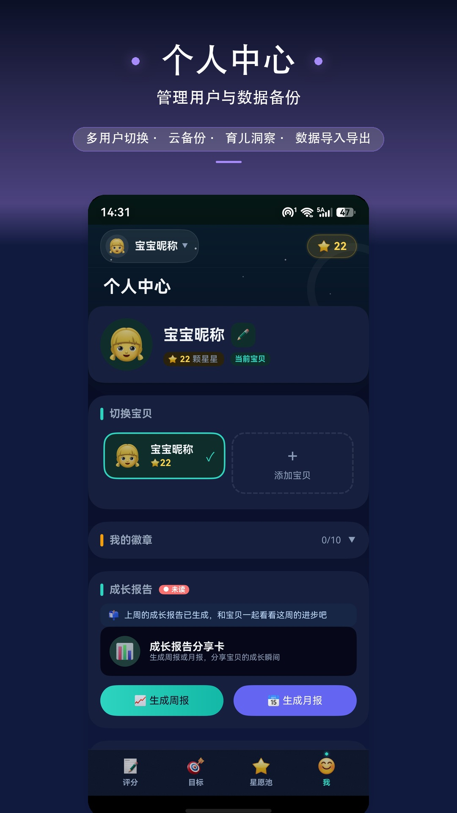

家庭多位成员，一人一份独立小宇宙。

- 👥 家庭共享：支持创建多个用户账户，快速切换，独立星星账户与打卡记录
- 🧩 独立目标管理：成员可各自维护目标列表，也可使用共享目标
- 🏅 徽章墙与星座收藏墙：半屏抽屉浏览全量收藏
- 📆 完成热力：近三个月打卡日历，金色越亮完成度越高，点格子直达当天评分页
- ☁️ WebDAV 云备份（保留最近 5 个版本）、本地导出为单包 zip（数据、照片、语音留言全打包）、成长时光周报/月报分享，都在「我」页管理

> 完整介绍见 [APP_VERSION_INTRO.md](APP_VERSION_INTRO.md)

---

### 📏 成长档案

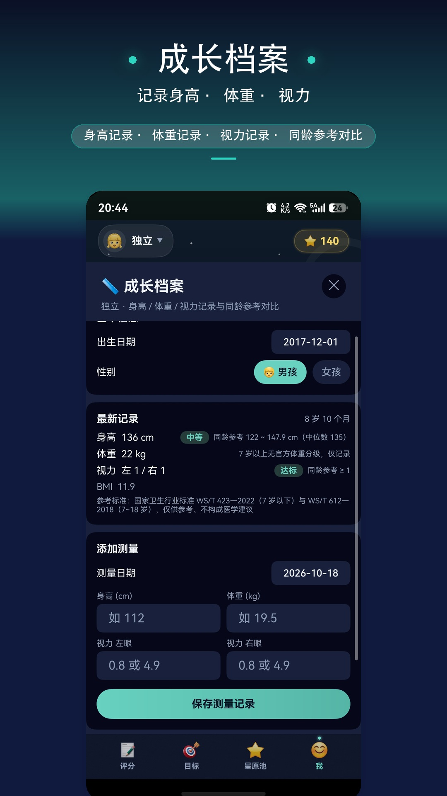

孩子长多高了？视力达标没？养娃不能只凭感觉，得有数据。

- 📏 身高/体重/视力一键记录，支持多次测量、历史回看
- 📊 同龄参考科学对比：依据国家卫生行业标准（WS/T 423—2022、WS/T 612—2018），身高/体重五档定位、视力达标判断、BMI 计算
- 👀 视力专项关注：左眼右眼分开记，早发现早干预
- 👨‍👩‍👧 多娃家庭独立建档，大宝二宝各自专属档案，数据互不干扰

> 完整介绍见 [growth.md](growth.md)，参考标准仅供日常记录参考，不构成医学建议

---

### 📔 成长日记

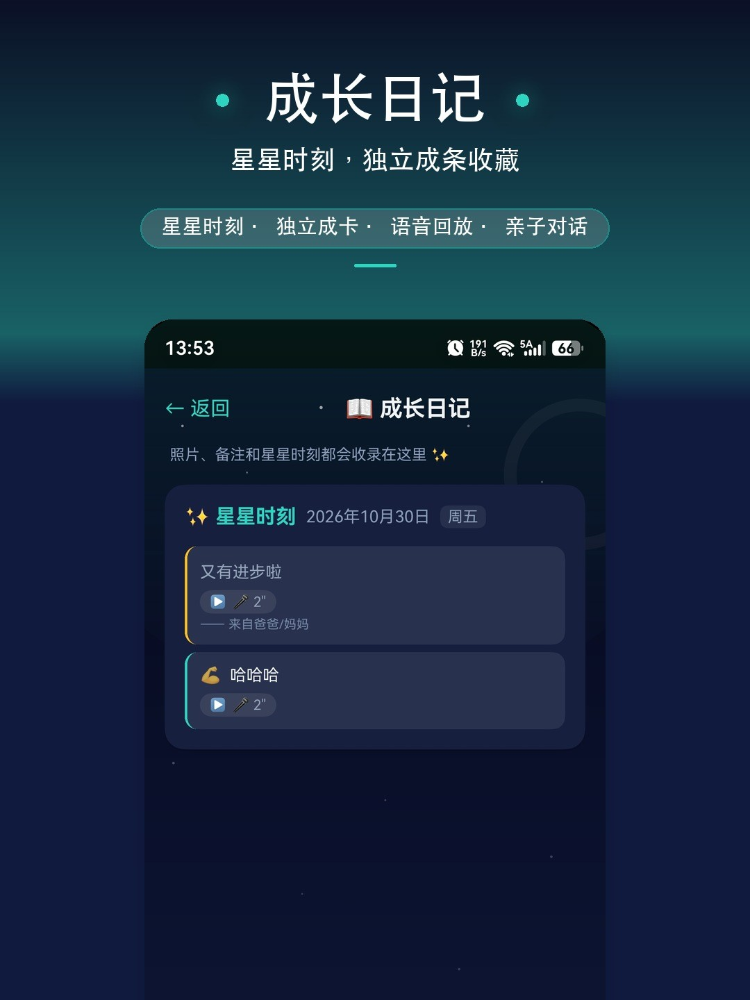

照片、备注和星星时刻都会收录在这里。星星记下的是这一天做成了什么，日记留住的是这一天为什么值得。

- ✨ 星星时刻独立成卡：✨ 标题头 + 日期，家长金线引用、宝贝青线回应
- ▶️ 语音留言随时点开重听，亲子对话原声保存
- 🌙 只写感受、没拍照片的日子，日记也会收藏

> 完整介绍见 [APP_VERSION_INTRO.md](APP_VERSION_INTRO.md)

---

## 🗂 应用结构

应用采用底部 TabBar 四页签架构：

| 页签 | 功能定位 |
|------|---------|
| 评分 | 每日打卡评分，记录任务完成情况 |
| 目标 | 目标任务的创建与管理 |
| 星愿池 | 星星兑换奖励心愿 |
| 我的 | 用户管理、数据备份、应用设置 |

此外还包含：成长洞察（本地分析引擎）、系统级提醒（每日汇总/周报，节假日免提醒）、云端备份与恢复（WebDAV，保留最近 5 个版本）、本地导出导入（单包 zip，数据/照片/语音全打包）等功能，详见 [APP_VERSION_INTRO.md](APP_VERSION_INTRO.md)。

---

## 🚀 版本更新

### v1.6.1 —— 星星时刻，把感受说给彼此

- ✨ **星星时刻**：当天全部任务评完、庆祝落幕后自动弹出，一天一次不打扰；快捷鼓励一句话或录一段语音，把手机递给宝贝，心情与回应双向流动
- 📔 **成长日记升级**：星星时刻独立成卡（家长金线引用 + 宝贝青线回应），语音随时点开重听；只写感受没拍照的日子也收藏
- ✅ **睡前一键收尾升级**：有清单目标先开选择面板，没评的自动勾好，底部实时显示「评满所选 N 项」
- 📦 **换机备份一条不落**：本地导出改单包 zip，数据、照片和语音留言全打包；旧版散文件备份照常能导入
- 🎨 弹窗按钮固定底栏、选填设置收进折叠区、桌面卡片子项名完整展示与「换一批」

> 完整更新说明见 [xhs_v161_update.md](xhs_v161_update.md)

### v1.6.0 —— 目标拆小的艺术，星空活了

- 🧩 **子项清单**：大目标最多拆 8 项，做完一项少一项，逐项单独评分攒星，全部完成目标自动「毕业」留纪念章
- ☄️ **星空活了**：打卡星图铺满大小错落会眨眼的星星，金色流星偶过夜空，整片夜空不再黑压压
- 🖥 **全屏沉浸**：打开星图就是整屏航线，今日营地完整落进视野
- 📱 **桌面卡片「选一项评分」**：多项没完成时直接选今天做完的那项，一点静默评满；只剩一项一键收尾

> 完整更新说明见 [xhs_v160_update.md](xhs_v160_update.md)

### v1.5.9 —— 回望与喘口气

- 🌌 **星图回望**：点亮过的历史节点可点开回看当天的任务、星星、备注和瞬间照片；只拍照没打分的日子带 📷 标记
- 🚀 **远征日志 + 一键分享**：星图顶部积累总览，📤 一键生成夜空航线分享长图
- 📆 **「我」页完成热力**：近三个月打卡日历，一眼看清哪天点亮、哪天满星、哪天休息
- ▶️ **下一步行动**：给大目标写一句「今天可以先做的一小步」，评分卡上直接展示
- 😴 **弹性休息日**：生病、出差一键标记休息，不断卡、不长废墟、提醒静默；目标支持 ⏸ 暂停，历史全保留

> 完整更新说明见 [v159_update.md](v159_update.md)

### v1.5.8 —— 给坚持放烟花

- 🎆 **星图烟花/流星补放演出**：弹窗里说的烟花流星，打开星图就能看到真实演出
- 🎁 **星图惊喜奖励送星**：路边宝箱开箱得 5 星，集齐 12 次彩蛋合成彗星卡再得 12 星
- 📸 **全部评完拍「今日瞬间」**：轻量提示拍照留念，全部满星仍走全屏庆祝
- 📊 **分享报告内嵌下载二维码**：周报/月报分享图底部自带应用市场二维码
- 🧹 庆祝动效全面焕新、补卡窗口收紧为最近 3 天、体积与可靠性治理

> 完整更新说明见 [v158_update.md](v158_update.md)

---

## 🔒 隐私安全

- 所有数据本地存储（Preferences），保护隐私，无需注册账号，离线可用
- 成长洞察、完成热力等分析全部本地计算，不上传任何数据
- WebDAV 云备份采用 HTTPS 加密传输，云端备份可选、由你手动决定
- 单机优先 · 无内购 · 星星靠坚持获得，不用花钱买

---

## 📁 仓库目录

```
.
├── APP_VERSION_INTRO.md   # 应用完整介绍（含核心功能与版本更新亮点）
├── comments.md            # 每日打卡评分 · 推广文案
├── goals.md               # 目标管理 · 推广文案
├── growth.md              # 成长档案 · 推广文案
├── images/                # 应用市场介绍图（夜空星愿主题 9:16 长图）
├── starpath.md            # 点亮星路 · 推广文案
├── statistic.md           # 每日打卡统计 · 推广文案
├── v158_update.md         # 1.5.8 版本更新 · 推广文案
├── v159_update.md         # 1.5.9 版本更新 · 推广文案
├── website.md             # 推广官网一览 · 导流文案
├── widgets.md             # 桌面服务卡片 · 推广文案
├── wishpool.md            # 星愿兑换 · 推广文案
├── xhs_v160_update.md     # 1.6.0 版本更新 · 推广文案
└── xhs_v161_update.md     # 1.6.1 版本更新 · 推广文案
```

---

> 让每一个小小的进步都被看见，让好习惯的养成充满乐趣。
